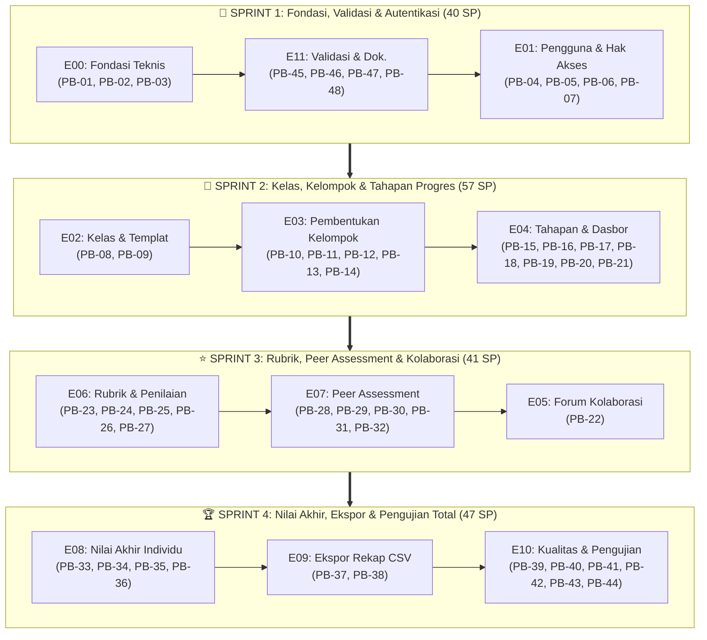

# 🗂️ Sprint Plan — 1 Sprint = 3 Epic (4 Sprint Total)
**Proyek:** Pengembangan Sistem Manajemen Pembelajaran Berbasis Proyek dengan Rubrik Penilaian Digital dan Peer Assessment Berbasis Web  
**PM:** Karina Cahyasari | **Versi:** 3.0 (3 Epics per Sprint) | **Tanggal:** 21 November 2026

> [!IMPORTANT]
> Sesuai arahan, struktur pengerjaan dibagi menjadi **1 Sprint = 3 Epic utuh**. Tidak ada epic yang dipotong atau menyeberang antar sprint.  
> Karena terdapat **12 Epic (E00–E11)**, maka keseluruhan proyek diselesaikan dalam **4 Sprint**.

---

## ⚙️ Tech Stack & Keputusan Arsitektur

| Komponen | Keputusan |
|----------|-----------|
| **Backend** | TypeScript + NestJS |
| **Frontend** | React / Vue |
| **Database** | PostgreSQL |
| **ORM** | MikroORM |
| **Containerisasi** | Docker (`docker-compose`) |
| **Branching Strategy** | `main` (stable), `be` (backend), `fe` (frontend) |
| **CI/CD** | ⏸️ Di-hold (belum ada rencana deploy ke production) |

---

## 📊 Ringkasan 4 Sprint (3 Epic per Sprint)

| Sprint | Daftar Epic yang Dikerjakan | Fokus & Tema Sprint | Jml PB | Total SP |
|:------:|-----------------------------|---------------------|:------:|:--------:|
| **Sprint 1** | **E00** · Setup & Fondasi Teknis **E11** · Validasi Kebutuhan & Dok. **E01** · Pengguna & Hak Akses | **Fondasi, Validasi & Autentikasi** Setup docker/repo/DB, riset/wawancara dosen, login & RBAC | 11 PB | 40 SP |
| **Sprint 2** | **E02** · Kelas & Templat Proyek **E03** · Pembentukan Kelompok **E04** · Tahapan & Pemantauan Progres | **Struktur Kelas, Tim & Progres** Template PBL, pembagian tim (3 metode), submit tugas & dasbor | 14 PB | 57 SP |
| **Sprint 3** | **E06** · Rubrik & Penilaian Kelompok **E07** · Peer Assessment **E05** · Ruang Kolaborasi Kelompok | **Evaluasi, Penilaian & Kolaborasi** Rubrik digital, peer assessment anonim anti-duplikasi, forum tim | 11 PB | 41 SP |
| **Sprint 4** | **E08** · Nilai Akhir Individu **E09** · Ekspor Rekapitulasi **E10** · Kualitas, Keamanan & Pengujian | **Kalkulasi Akhir, Ekspor & Hardening** Formula faktor pengali, publikasi nilai, CSV export, E2E test & walkthrough | 12 PB | 47 SP |
| **TOTAL** | **12 Epic Utuh** | **Semua fitur PRD terselesaikan** | **48 PB** | **185 SP** |

---

## 🗺️ Roadmap Visual Alur 4 Sprint

---

## 🚀 SPRINT 1 — Fondasi, Validasi & Autentikasi
**Epic yang Diselesaikan:** E00 (Setup & Fondasi Teknis), E11 (Validasi Kebutuhan & Dok.), E01 (Pengguna & Hak Akses)  
**Total Beban:** 11 User Stories | **40 Story Points**

### Sprint Goal
> Menyiapkan repositori & container Docker, merancang skema ERD di PostgreSQL via MikroORM, melakukan wawancara validasi dosen & studi formula kontribusi, serta menerapkan autentikasi lokal dan RBAC (Dosen, Mahasiswa, Admin).

### Backlog Sprint 1

#### 📦 Epic E00 — Setup & Fondasi Teknis (11 SP)
| ID | User Story | Role | SP | Pri. | Acceptance Criteria |
|----|------------|------|:--:|:----:|---------------------|
| **PB-01** | Setup repositori, struktur proyek, dan docker dev/staging | Tim Dev | 3 | M | - Repositori Git dengan branch `main`, `be`, `fe` - Kerangka NestJS + React/Vue jalan via Docker - README panduan setup tersedia |
| **PB-02** | Rancang skema database (ERD) dan migrasi data | Tim Dev | 5 | M | - ERD disetujui seluruh tim - Migrasi MikroORM jalan dari nol tanpa error - Relasi mendukung anonimitas penilai peer assessment |
| **PB-03** | Sediakan seed script data sintetis (dummy data) | Tim Dev | 3 | M | - Seed script dapat dijalankan berulang - Bebas dari nama/NIM/nilai riil |

#### 📚 Epic E11 — Validasi Kebutuhan & Dokumentasi (9 SP)
| ID | User Story | Role | SP | Pri. | Acceptance Criteria |
|----|------------|------|:--:|:----:|---------------------|
| **PB-45** | Wawancara dosen offline untuk validasi alur & rubrik | Tim Dev | 2 | M | - Panduan wawancara dibuat - Rangkuman hasil wawancara selesai & temuan memperbarui PRD Bagian B |
| **PB-46** | Sebarkan kuesioner anonim ke mahasiswa Informatika | Tim Dev | 2 | S | - Kuesioner dibagikan & bersifat anonim - Hanya laporan data agregat yang dipublikasikan |
| **PB-47** | Kajian literatur rumus peer assessment & faktor pengali | Tim Dev | 3 | S | - Minimal beberapa literatur ilmiah disitir - Rumus acuan untuk FR-09 disepakati |
| **PB-48** | Review acceptance criteria bersama dosen & update PRD | Tim Dev | 2 | M | - Bagian H PRD disetujui dosen - PRD v0.2 terbit |

#### 🔐 Epic E01 — Pengguna & Hak Akses (20 SP)
| ID | User Story | Role | SP | Pri. | Acceptance Criteria |
|----|------------|------|:--:|:----:|---------------------|
| **PB-04** | Login akun lokal terenkripsi | Semua | 5 | M | - Password ter-hash (argon2/bcrypt) - Pesan error umum saat gagal login - Sesi berakhir saat logout |
| **PB-05** | Diferensiasi hak akses 3 peran via Guard | Sistem | 5 | M | - NestJS Guard membatasi akses peran - Mahasiswa tidak bisa tembus endpoint dosen/admin - Hanya dosen yang bisa input nilai |
| **PB-06** | Admin: CRUD akun dan manajemen peran | Admin | 5 | M | - Admin dapat CRUD akun & aktif/nonaktifkan user - Akun nonaktif tidak bisa login |
| **PB-07** | Admin: CRUD mata kuliah & pendaftaran peserta | Admin | 5 | M | - Admin membuat master mata kuliah - Mahasiswa didaftarkan ke kelas - Daftar peserta muncul di sisi dosen |

### Deliverables Utama Sprint 1
- [ ] Repo aktif (`main`, `be`, `fe`) + `docker-compose.yml` (NestJS + PostgreSQL)
- [ ] ERD v1 + migration files MikroORM + seed script data dummy
- [ ] Dokumen validasi wawancara dosen + formula faktor pengali hasil kajian literatur
- [ ] PRD v0.2 yang telah disetujui
- [ ] Modul Auth (JWT/Session) + NestJS Role Guards
- [ ] Modul Admin untuk kelola akun, hak akses, dan mata kuliah

---

## 🏫 SPRINT 2 — Kelas, Kelompok & Tahapan Progres
**Epic yang Diselesaikan:** E02 (Kelas & Templat Proyek), E03 (Pembentukan Kelompok), E04 (Tahapan & Pemantauan Progres)  
**Total Beban:** 14 User Stories | **57 Story Points**

### Sprint Goal
> Dosen dapat membuat kelas dengan template project-based, membagi mahasiswa ke dalam kelompok (acak, mandiri, manual), serta mengelola tahapan proyek lengkap dengan pengumpulan luaran dan dasbor pemantauan.

### Backlog Sprint 2

#### 🏫 Epic E02 — Kelas & Templat Proyek (8 SP)
| ID | User Story | Role | SP | Pri. | Acceptance Criteria |
|----|------------|------|:--:|:----:|---------------------|
| **PB-08** | Dosen: membuat kelas baru | Dosen | 3 | M | - Dosen input nama kelas & pilih mata kuliah - Kelas tersimpan dan tampil di daftar kelas dosen |
| **PB-09** | Dosen: inisiasi kelas dengan Project-Based Template | Dosen | 5 | M | - Memilih template PBL langsung mengisi alur tahapan awal - Minimal ada 1 tahapan ber-deadline valid agar kelas aktif |

#### 👥 Epic E03 — Pembentukan Kelompok (19 SP)
| ID | User Story | Role | SP | Pri. | Acceptance Criteria |
|----|------------|------|:--:|:----:|---------------------|
| **PB-10** | Dosen: konfigurasi metode pembagian & kapasitas tim (N) | Dosen | 2 | M | - Pilihan 3 metode (acak, mandiri, manual) tersedia - Batasan N anggota divalidasi |
| **PB-11** | Dosen: randomizer pembagian kelompok otomatis | Dosen | 5 | M | - Mahasiswa terdistribusi merata otomatis - Tidak ada mahasiswa terdaftar ganda di >1 tim |
| **PB-12** | Mahasiswa: self-enroll memilih slot kelompok mandiri | Mhs | 5 | M | - Mahasiswa memilih slot yang masih tersedia - Aman dari race condition saat 2 mhs memilih slot terakhir bersamaan |
| **PB-13** | Dosen: atur & pindahkan anggota kelompok manual | Dosen | 5 | M | - Dosen bebas menetapkan/memindahkan mahasiswa antar-tim - Data langsung terupdate real-time |
| **PB-14** | Mahasiswa: melihat informasi tim sendiri | Mhs | 2 | M | - Mahasiswa melihat daftar rekan satu kelompoknya - Tidak dapat melihat detail rahasia tim lain |

#### 📅 Epic E04 — Tahapan & Pemantauan Progres (30 SP)
| ID | User Story | Role | SP | Pri. | Acceptance Criteria |
|----|------------|------|:--:|:----:|---------------------|
| **PB-15** | Dosen: tambah tahapan (milestone) & deadline | Dosen | 5 | M | - Tahapan wajib memiliki nama & tenggat waktu valid - Menjadi syarat kelas dapat berjalan |
| **PB-16** | Dosen: edit, hapus, dan atur urutan tahapan | Dosen | 3 | M | - Milestone dapat diurutkan ulang - Peringatan konfirmasi jika menghapus tahapan yang sudah ada file submission |
| **PB-17** | Perwakilan tim: upload berkas/link tugas per tahapan | Mhs | 5 | M | - Mengunggah link/file mengubah status menjadi Submitted - Terlihat seketika pada monitor dosen |
| **PB-18** | Sistem: kalkulasi status tahapan otomatis | Dosen | 3 | M | - Status berubah: Belum Dikumpulkan, Submitted, atau Terlambat (lewat deadline) |
| **PB-19** | Dosen: dasbor pemantauan matrix (Kelompok × Tahapan) | Dosen | 8 | M | - Grid kelompok × tahapan menampilkan status terkini - Filter per tahapan/kelompok berjalan cepat |
| **PB-20** | Dosen: beri catatan/umpan balik pengumpulan *(Could)* | Dosen | 3 | C | - Dosen dapat memberi komentar pada submission - Mahasiswa dalam kelompok dapat membacanya |
| **PB-21** | Mahasiswa: reminder deadline di dasbor *(Could)* | Mhs | 3 | C | - Notifikasi visual di dasbor mhs ketika tenggat mendekat |

### Deliverables Utama Sprint 2
- [ ] Fitur pembuatan kelas berbasis Project-Based Template
- [ ] 3 mekanisme pembentukan kelompok (Random algorithm, Self-enroll with PostgreSQL locking, Manual assignment)
- [ ] Halaman tim mahasiswa (restricted view)
- [ ] Modul tahapan proyek (CRUD & reordering milestone)
- [ ] Antarmuka penyerahan tugas (file/link upload)
- [ ] Dasbor matriks pemantauan progres kelompok bagi dosen

---

## ⭐ SPRINT 3 — Evaluasi, Penilaian & Kolaborasi
**Epic yang Diselesaikan:** E06 (Rubrik & Penilaian Kelompok), E07 (Peer Assessment), E05 (Ruang Kolaborasi Kelompok)  
**Total Beban:** 11 User Stories | **41 Story Points**

### Sprint Goal
> Dosen dapat membuat rubrik penilaian (validasi bobot 100%) dan menilai kelompok secara objektif. Mahasiswa dapat menilai kontribusi rekan tim melalui formulir peer assessment yang anonim, aman dari penilaian diri sendiri, dan idempoten (anti-duplikasi). Tim memiliki forum diskusi internal.

### Backlog Sprint 3

#### 📝 Epic E06 — Rubrik & Penilaian Kelompok (17 SP)
| ID | User Story | Role | SP | Pri. | Acceptance Criteria |
|----|------------|------|:--:|:----:|---------------------|
| **PB-23** | Dosen: buat rubrik kustom (kriteria, bobot, skala level) | Dosen | 5 | M | - Dosen dapat menambah/mengubah kriteria & deskripsi level - Struktur rubrik tersimpan rapi |
| **PB-24** | Sistem: validasi ketat total bobot rubrik tepat 100% | Dosen | 2 | M | - Penyimpanan berhasil HANYA jika total bobot tepat 100% - Muncul alert error jika total < 100% atau > 100% |
| **PB-25** | Dosen: input nilai kelompok per kriteria rubrik | Dosen | 5 | M | - Form skor per kriteria sesuai level rubrik - Dilarang menginput di luar batas skala |
| **PB-26** | Sistem: hitung nilai agregat kelompok otomatis | Dosen | 3 | M | - Nilai kelompok = $\sum(\text{skor} \times \text{bobot})$ - Bersifat deterministik |
| **PB-27** | Dosen: finalisasi & konfirmasi nilai kelompok | Dosen | 2 | M | - Nilai yang difinalisasi terkunci - Perubahan setelah finalisasi tercatat di audit trail |

#### 🤝 Epic E07 — Peer Assessment (19 SP)
| ID | User Story | Role | SP | Pri. | Acceptance Criteria |
|----|------------|------|:--:|:----:|---------------------|
| **PB-28** | Dosen: buka dan tutup jadwal periode peer assessment | Dosen | 3 | M | - Periode berstatus Aktif/Tutup - Pengiriman saat periode ditutup otomatis ditolak |
| **PB-29** | Mahasiswa: mengisi skor kontribusi untuk semua anggota tim | Mhs | 5 | M | - Mahasiswa wajib mengisi nilai kontribusi rekan sekelompok - Skor harus dalam rentang valid |
| **PB-30** | Sistem: guard tolak penilaian diri sendiri & tim lain | Tim Dev | 3 | M | - Sistem menolak jika user mencoba menilai diri sendiri - Sistem menolak jika user menilai mahasiswa luar tim |
| **PB-31** | Sistem: pencegahan duplikasi data (idempoten & double-click) | Tim Dev | 5 | M | - Submit ganda ditolak di tingkat Database (`UNIQUE CONSTRAINT`) - Tidak ada duplicate entries |
| **PB-32** | Sistem: penjaminan anonimitas identitas penilai | Mhs | 3 | M | - UI yang dinilai sama sekali tidak menampilkan nama penilai - Payload API ke frontend mahasiswa disanitasi tanpa info identitas penilai |

#### 💬 Epic E05 — Ruang Kolaborasi Kelompok (5 SP)
| ID | User Story | Role | SP | Pri. | Acceptance Criteria |
|----|------------|------|:--:|:----:|---------------------|
| **PB-22** | Mahasiswa & Dosen: forum diskusi khusus per tim | Mhs | 5 | S | - Thread posting dan balasan berurutan kronologis - Hanya anggota kelompok tersebut dan dosen yang memiliki hak akses |

### Deliverables Utama Sprint 3
- [ ] Rubric builder interface dengan auto-calculate validator total bobot 100%
- [ ] Form penilaian luaran kelompok oleh dosen berbasis rubrik
- [ ] Modul scheduling periode peer assessment
- [ ] Form input peer assessment mahasiswa dengan validasi backend ketat (anti-self rating, role check)
- [ ] Proteksi database PostgreSQL (`UNIQUE(reviewer_id, reviewee_id, period_id)`)
- [ ] Sanitizer API untuk proteksi privasi anonimitas penilai
- [ ] Forum diskusi kelompok terisolasi

---

## 🏆 SPRINT 4 — Nilai Akhir, Ekspor & Pengujian Total
**Epic yang Diselesaikan:** E08 (Nilai Akhir Individu), E09 (Ekspor Rekapitulasi), E10 (Kualitas, Keamanan & Pengujian)  
**Total Beban:** 12 User Stories | **47 Story Points**

### Sprint Goal
> Menghitung nilai akhir individu menggunakan faktor pengali kontribusi, menyediakan review dosen sebelum publikasi, ekspor data rekapitulasi ke format CSV, menyelesaikan seluruh automated testing, serta melakukan validasi usability walkthrough.

### Backlog Sprint 4

#### 🏆 Epic E08 — Nilai Akhir Individu (19 SP)
| ID | User Story | Role | SP | Pri. | Acceptance Criteria |
|----|------------|------|:--:|:----:|---------------------|
| **PB-33** | Dosen: konfigurasi formula & ambang batas faktor pengali | Dosen | 3 | M | - Batas bawah & atas pengali (mis. 0.8 s/d 1.2) dapat diatur dosen - Validasi parameter masuk akal |
| **PB-34** | Sistem: kalkulasi otomatis nilai akhir individu | Tim Dev | 8 | M | - Nilai Individu = Nilai Kelompok × Indeks Kontribusi (maksimal 100) - Skor diri sendiri diabaikan - Bersifat deterministik |
| **PB-35** | Dosen: tinjau & lakukan adjustment nilai sebelum rilis *(Should)* | Dosen | 3 | S | - Dosen dapat melihat breakdown rekomendasi nilai tiap mahasiswa - Dosen dapat mengubah manual (terekam riwayat perubahan) |
| **PB-36** | Dosen: publikasi nilai akhir individu ke mahasiswa | Dosen | 5 | M | - Nilai baru tampil di akun mahasiswa setelah dipublikasikan - Mahasiswa HANYA bisa melihat nilainya sendiri |

#### 📤 Epic E09 — Ekspor Rekapitulasi (6 SP)
| ID | User Story | Role | SP | Pri. | Acceptance Criteria |
|----|------------|------|:--:|:----:|---------------------|
| **PB-37** | Dosen: ekspor rekap progres dan submission kelompok ke CSV | Dosen | 3 | S | - File CSV berisi daftar kelompok, milestone, status pengumpulan, dan timestamp - Hanya dapat diunduh oleh dosen |
| **PB-38** | Dosen: ekspor rekap nilai kelompok & individu ke CSV | Dosen | 3 | S | - File CSV memuat nilai kelompok, indeks kontribusi, dan nilai akhir individu - Angka 100% cocok dengan di database |

#### 🧪 Epic E10 — Kualitas, Keamanan & Pengujian (22 SP)
| ID | User Story | Role | SP | Pri. | Acceptance Criteria |
|----|------------|------|:--:|:----:|---------------------|
| **PB-39** | Antarmuka web responsif (desktop & mobile) | Semua | 3 | M | - Seluruh tampilan halaman utama rapi diakses via layar HP maupun laptop |
| **PB-40** | Automated unit test aturan bisnis kritis | Tim Dev | 5 | M | - Test suite NestJS (`npm test`) menguji: validasi rubrik 100%, rumus nilai individu, pencegahan skor >100, anti-duplikasi |
| **PB-41** | Security test: pengujian hak akses matriks peran | Tim Dev | 3 | M | - Pengujian endpoint memastikan role Mahasiswa ditolak saat akses URL/API dosen/admin |
| **PB-42** | Pengujian End-to-End (E2E) skenario UC-01 s/d UC-07 | Tim Dev | 5 | M | - Seluruh skenario UC-01 sampai UC-07 dijalankan dan semua acceptance criteria dinyatakan lulus |
| **PB-43** | Concurrency test: race condition & double-click submission | Tim Dev | 3 | M | - Uji beban bersamaan pada self-enroll dan pengiriman peer assessment tidak menghasilkan anomali data |
| **PB-44** | Walkthrough antarmuka dengan dosen & mahasiswa sukarela | Tim Dev | 3 | S | - Sesi evaluasi pengguna nyata dapat menyelesaikan pembuatan rubrik & peer review tanpa bimbingan tim teknis |

### Deliverables Utama Sprint 4
- [ ] Engine kalkulator nilai akhir individu dengan parameter konfigurasi dosen
- [ ] Panel review & override nilai bagi dosen
- [ ] Halaman rapor nilai akhir bagi mahasiswa (restricted view pribadi)
- [ ] Fitur ekspor berkas CSV (rekap progres & rekap nilai akademik)
- [ ] Desain responsif di semua halaman utama
- [ ] Test suite automated (unit test & RBAC integration test)
- [ ] Dokumen laporan hasil E2E testing dan walkthrough usability
- [ ] 🎉 **Sistem siap presentasi capstone project**

---

## ⚠️ Keputusan Kritis yang Wajib Diambil Sesuai Jadwal

| No | Topik Keputusan | Skenario Dampak | Target Sprint |
|:--:|-----------------|-----------------|:-------------:|
| 1 | **Formula Faktor Pengali Peer Assessment** | Menentukan implementasi matematis PB-34 | Selesai di **Sprint 1** (via PB-47) |
| 2 | **Kebijakan Perwakilan Kelompok** | Apakah submit progres bebas siapa saja dalam tim atau ditunjuk ketua? | Selesai sebelum **Sprint 2** (PB-17) |
| 3 | **Visibilitas Identitas Penilai ke Dosen** | Apakah dosen boleh melihat siapa menilai siapa, atau 100% anonim dari semua orang? | Selesai sebelum **Sprint 3** (PB-32) |
| 4 | **Model Akumulasi Nilai** | Apakah nilai per tahapan diakumulasikan, atau tahapan hanya syarat & nilai diambil dari luaran akhir? | Selesai di **Sprint 1** (saat wawancara dosen PB-45) |

---

## 📝 Definition of Done (DoD) per User Story

Setiap User Story dalam setiap Sprint dinyatakan **SELESAI (Done)** jika:
1. Seluruh butir **Acceptance Criteria** spesifik telah terverifikasi lulus.
2. Kode telah digabungkan ke branch yang sesuai (`be` atau `fe`) melalui Pull Request dengan review minimal 1 rekan tim.
3. Unit test otomatis untuk logika bisnis terkait sudah dibuat dan berstatus passing (`green`).
4. Bebas dari bug kategori *blocker* atau *critical*.
5. Dapat dijalankan secara konsisten pada environment Docker lokal.
6. Catatan dokumentasi/README diperbarui bila ada konfigurasi baru.
