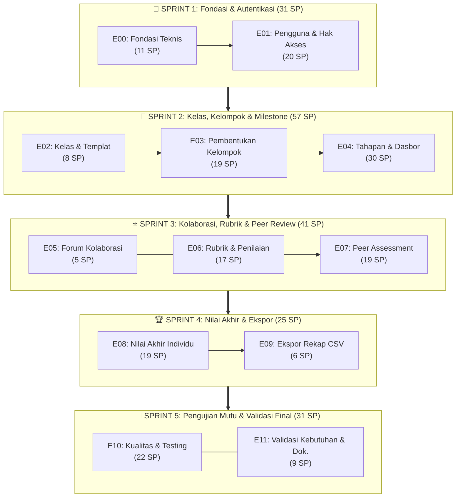

# 🗂️ Sprint Plan — 5 Sprint (E00–E11)
**Proyek:** Pengembangan Sistem Manajemen Pembelajaran Berbasis Proyek dengan Rubrik Penilaian Digital dan Peer Assessment Berbasis Web  
**PM:** Karina Cahyasari | **Versi:** 4.0 (5-Sprint Plan) | **Tanggal:** 23 November 2026

---

## ⚙️ Tech Stack & Strategi Tim

| Komponen | Keputusan |
|----------|-----------|
| **Backend** | TypeScript + NestJS + MikroORM (PostgreSQL) |
| **Frontend** | React (Vite + TypeScript) + Tailwind CSS v4 (Neobrutalism Design) |
| **Database** | PostgreSQL 16 (Docker) |
| **Branching** | `main` (stable), `BE` (jobdesk backend), `FE` (jobdesk frontend) |
| **Eksekusi Dev** | `npm run dev` (root concurrently) |

---

## 📊 Ringkasan 5 Sprint

| Sprint | Epic yang Dikerjakan | Fokus & Tema Sprint | Jml PB | Total SP |
|:------:|----------------------|---------------------|:------:|:--------:|
| **Sprint 1** | **E00** · Setup & Fondasi Teknis **E01** · Pengguna & Hak Akses | **Fondasi, Arsitektur & Autentikasi** Setup repo/docker, skema DB awal, login lokal, session, dan RBAC (Admin, Dosen, Mahasiswa) | 7 PB | **31 SP** |
| **Sprint 2** | **E02** · Kelas & Templat Proyek **E03** · Pembentukan Kelompok **E04** · Tahapan & Pemantauan Progres | **Pengelolaan Kelas, Kelompok & Progres** Template PBL, 3 metode kelompok (acak/mandiri/manual), penyerahan milestone & dasbor pemantauan dosen | 14 PB | **57 SP** |
| **Sprint 3** | **E05** · Ruang Kolaborasi Kelompok **E06** · Rubrik & Penilaian Kelompok **E07** · Peer Assessment | **Kolaborasi, Rubrik & Peer Review** Forum diskusi tim, rubrik digital (bobot 100%), penilaian luaran, dan modul peer assessment anonim anti-duplikasi | 11 PB | **41 SP** |
| **Sprint 4** | **E08** · Nilai Akhir Individu **E09** · Ekspor Rekapitulasi | **Kalkulasi Nilai Akhir & Pelaporan** Formula faktor pengali kontribusi, review & adjustment dosen, publikasi nilai, dan ekspor CSV | 6 PB | **25 SP** |
| **Sprint 5** | **E10** · Kualitas, Keamanan & Pengujian **E11** · Validasi Kebutuhan & Dokumentasi | **Hardening, Pengujian E2E & Validasi Akhir** Unit testing aturan bisnis, security RBAC test, concurrency test, walkthrough usability, dan dokumentasi PRD final disetujui dosen | 10 PB | **31 SP** |
| **TOTAL** | **12 Epic Utuh** | **Semua kebutuhan PRD terpenuhi tanpa pemotongan epic** | **48 PB** | **185 SP** |

---

## 🗺️ Roadmap Alur 5 Sprint

---

## 🚀 SPRINT 1 — Fondasi, Arsitektur & Autentikasi
**Epic:** E00 (Setup & Fondasi Teknis) + E01 (Pengguna & Hak Akses)  
**Total Beban:** 7 User Stories | **31 Story Points**

### Sprint Goal
> Repositori dan docker dev environment aktif, skema ERD PostgreSQL dirancang via MikroORM, dan sistem autentikasi lokal terenkripsi dengan RBAC (Dosen, Mahasiswa, Admin) ditegakkan di backend dan frontend.

### Backlog Sprint 1

#### 📦 Epic E00 — Setup & Fondasi Teknis (11 SP)
| ID | User Story | Role | SP | Pri. | Acceptance Criteria |
|----|------------|------|:--:|:----:|---------------------|
| **PB-01** | Setup repositori, struktur proyek, dan docker dev/staging | Tim Dev | 3 | M | - Repositori Git dengan branch `main`, `BE`, `FE` - Kerangka NestJS + React Vite jalan via root `npm run dev` - README panduan setup tersedia |
| **PB-02** | Rancang skema database (ERD) dan migrasi data | Tim Dev | 5 | M | - ERD disetujui seluruh tim - Migrasi MikroORM jalan dari nol tanpa error - Relasi mendukung anonimitas penilai peer assessment |
| **PB-03** | Sediakan seed script data sintetis (dummy data) | Tim Dev | 3 | M | - Seed script dapat dijalankan berulang - Bebas dari nama/NIM/nilai riil |

#### 🔐 Epic E01 — Pengguna & Hak Akses (20 SP)
| ID | User Story | Role | SP | Pri. | Acceptance Criteria |
|----|------------|------|:--:|:----:|---------------------|
| **PB-04** | Login akun lokal terenkripsi | Semua | 5 | M | - Password ter-hash (argon2/bcrypt) - Pesan error umum saat gagal login - Sesi berakhir saat logout |
| **PB-05** | Diferensiasi hak akses 3 peran via Guard | Sistem | 5 | M | - NestJS Guard membatasi akses peran - Mahasiswa tidak bisa tembus endpoint dosen/admin - Hanya dosen yang bisa input nilai |
| **PB-06** | Admin: CRUD akun dan manajemen peran | Admin | 5 | M | - Admin dapat CRUD akun & aktif/nonaktifkan user - Akun nonaktif tidak bisa login |
| **PB-07** | Admin: CRUD mata kuliah & pendaftaran peserta | Admin | 5 | M | - Admin membuat master mata kuliah - Mahasiswa didaftarkan ke kelas - Daftar peserta muncul di sisi dosen |

---

## 🏫 SPRINT 2 — Pengelolaan Kelas, Kelompok & Progres
**Epic:** E02 (Kelas & Templat Proyek) + E03 (Pembentukan Kelompok) + E04 (Tahapan & Pemantauan Progres)  
**Total Beban:** 14 User Stories | **57 Story Points**

### Sprint Goal
> Dosen dapat membuat kelas proyek PBL, membagi mahasiswa ke kelompok dengan 3 metode (acak, mandiri, manual), serta mengelola alur tahapan (milestone) proyek lengkap dengan dasbor monitoring pengumpulan.

### Backlog Sprint 2

#### 🏫 Epic E02 — Kelas & Templat Proyek (8 SP)
| ID | User Story | Role | SP | Pri. | Acceptance Criteria |
|----|------------|------|:--:|:----:|---------------------|
| **PB-08** | Dosen: membuat kelas baru | Dosen | 3 | M | - Dosen input nama kelas & pilih mata kuliah - Kelas tersimpan dan tampil di daftar kelas dosen |
| **PB-09** | Dosen: inisiasi kelas dengan Project-Based Template | Dosen | 5 | M | - Memilih template PBL langsung mengisi tahapan awal - Minimal ada 1 tahapan ber-deadline valid agar kelas aktif |

#### 👥 Epic E03 — Pembentukan Kelompok (19 SP)
| ID | User Story | Role | SP | Pri. | Acceptance Criteria |
|----|------------|------|:--:|:----:|---------------------|
| **PB-10** | Dosen: konfigurasi metode pembagian & kapasitas tim ($N$) | Dosen | 2 | M | - Pilihan 3 metode (acak, mandiri, manual) tersedia - Batasan $N$ anggota divalidasi |
| **PB-11** | Dosen: randomizer pembagian kelompok otomatis | Dosen | 5 | M | - Mahasiswa terdistribusi merata otomatis - Tidak ada mahasiswa terdaftar ganda di >1 tim |
| **PB-12** | Mahasiswa: self-enroll memilih slot kelompok mandiri | Mhs | 5 | M | - Mahasiswa memilih slot yang masih tersedia - Aman dari race condition saat 2 mhs memilih slot terakhir bersamaan |
| **PB-13** | Dosen: atur & pindahkan anggota kelompok manual | Dosen | 5 | M | - Dosen bebas menetapkan/memindahkan mahasiswa antar-tim - Data langsung terupdate real-time |
| **PB-14** | Mahasiswa: melihat informasi tim sendiri | Mhs | 2 | M | - Mahasiswa melihat daftar rekan satu kelompoknya - Tidak dapat melihat detail rahasia tim lain |

#### 📅 Epic E04 — Tahapan & Pemantauan Progres (30 SP)
| ID | User Story | Role | SP | Pri. | Acceptance Criteria |
|----|------------|------|:--:|:----:|---------------------|
| **PB-15** | Dosen: tambah tahapan (milestone) & deadline | Dosen | 5 | M | - Tahapan wajib memiliki nama & tenggat waktu valid - Menjadi syarat kelas dapat berjalan |
| **PB-16** | Dosen: edit, hapus, dan atur urutan tahapan | Dosen | 3 | M | - Milestone dapat diurutkan ulang - Peringatan konfirmasi jika menghapus tahapan yang sudah ada file submission |
| **PB-17** | Perwakilan tim: upload berkas/link tugas per tahapan | Mhs | 5 | M | - Mengunggah link/file mengubah status menjadi Submitted - Terlihat seketika pada monitor dosen |
| **PB-18** | Sistem: kalkulasi status tahapan otomatis | Dosen | 3 | M | - Status berubah: Belum Dikumpulkan, Submitted, atau Terlambat |
| **PB-19** | Dosen: dasbor pemantauan matrix (Kelompok × Tahapan) | Dosen | 8 | M | - Grid kelompok × tahapan menampilkan status terkini - Filter per tahapan/kelompok berjalan cepat |
| **PB-20** | Dosen: beri catatan/umpan balik pengumpulan *(Could)* | Dosen | 3 | C | - Dosen dapat memberi komentar pada submission - Mahasiswa dalam kelompok dapat membacanya |
| **PB-21** | Mahasiswa: reminder deadline di dasbor *(Could)* | Mhs | 3 | C | - Notifikasi visual di dasbor mhs ketika tenggat mendekat |

---

## ⭐ SPRINT 3 — Kolaborasi, Rubrik & Peer Review
**Epic:** E05 (Ruang Kolaborasi Kelompok) + E06 (Rubrik & Penilaian Kelompok) + E07 (Peer Assessment)  
**Total Beban:** 11 User Stories | **41 Story Points**

### Sprint Goal
> Tim mahasiswa memiliki forum diskusi khusus. Dosen dapat membuat rubrik kustom (validasi bobot 100%) dan menilai kelompok. Mahasiswa dapat mengisi peer assessment secara anonim, aman dari penilaian diri sendiri, dan idempoten (anti-duplikasi).

### Backlog Sprint 3

#### 💬 Epic E05 — Ruang Kolaborasi Kelompok (5 SP)
| ID | User Story | Role | SP | Pri. | Acceptance Criteria |
|----|------------|------|:--:|:----:|---------------------|
| **PB-22** | Mahasiswa & Dosen: forum diskusi khusus per tim | Mhs | 5 | S | - Thread posting dan balasan berurutan kronologis - Hanya anggota kelompok tersebut dan dosen yang memiliki hak akses |

#### 📝 Epic E06 — Rubrik & Penilaian Kelompok (17 SP)
| ID | User Story | Role | SP | Pri. | Acceptance Criteria |
|----|------------|------|:--:|:----:|---------------------|
| **PB-23** | Dosen: buat rubrik kustom (kriteria, bobot, skala level) | Dosen | 5 | M | - Dosen dapat menambah/mengubah kriteria & deskripsi level - Struktur rubrik tersimpan rapi |
| **PB-24** | Sistem: validasi ketat total bobot rubrik tepat 100% | Dosen | 2 | M | - Penyimpanan berhasil HANYA jika total bobot tepat 100% - Muncul alert error jika total ≠ 100% |
| **PB-25** | Dosen: input nilai kelompok per kriteria rubrik | Dosen | 5 | M | - Form skor per kriteria sesuai level rubrik - Dilarang menginput di luar batas skala |
| **PB-26** | Sistem: hitung nilai agregat kelompok otomatis | Dosen | 3 | M | - Nilai kelompok = $\sum(\text{skor} \times \text{bobot})$ - Bersifat deterministik |
| **PB-27** | Dosen: finalisasi & konfirmasi nilai kelompok | Dosen | 2 | M | - Nilai yang difinalisasi terkunci - Perubahan setelah finalisasi tercatat di audit trail |

#### 🤝 Epic E07 — Peer Assessment (19 SP)
| ID | User Story | Role | SP | Pri. | Acceptance Criteria |
|----|------------|------|:--:|:----:|---------------------|
| **PB-28** | Dosen: buka dan tutup jadwal periode peer assessment | Dosen | 3 | M | - Periode berstatus Aktif/Tutup - Pengiriman saat periode ditutup otomatis ditolak |
| **PB-29** | Mahasiswa: mengisi skor kontribusi untuk semua anggota tim | Mhs | 5 | M | - Mahasiswa wajib mengisi nilai kontribusi rekan sekelompok - Skor harus dalam rentang valid |
| **PB-30** | Sistem: guard tolak penilaian diri sendiri & tim lain | Tim Dev | 3 | M | - Sistem menolak jika user mencoba menilai diri sendiri - Sistem menolak jika user menilai mahasiswa luar tim |
| **PB-31** | Sistem: pencegahan duplikasi data (idempoten & double-click) | Tim Dev | 5 | M | - Submit ganda ditolak di tingkat Database (`UNIQUE CONSTRAINT`) - Tidak ada duplicate entries |
| **PB-32** | Sistem: penjaminan anonimitas identitas penilai | Mhs | 3 | M | - UI yang dinilai sama sekali tidak menampilkan nama penilai - Payload API ke frontend mahasiswa disanitasi tanpa info identitas penilai |

---

## 🏆 SPRINT 4 — Nilai Akhir & Ekspor Pelaporan
**Epic:** E08 (Nilai Akhir Individu) + E09 (Ekspor Rekapitulasi)  
**Total Beban:** 6 User Stories | **25 Story Points**

### Sprint Goal
> Sistem menghitung nilai akhir individu berdasarkan faktor kontribusi peer assessment dengan batasan konfigurasi dosen. Dosen dapat meninjau breakdown nilai, melakukan penyesuaian, mempublikasikan nilai ke mahasiswa, serta mengekspor seluruh rekap data ke format CSV.

### Backlog Sprint 4

#### 🏆 Epic E08 — Nilai Akhir Individu (19 SP)
| ID | User Story | Role | SP | Pri. | Acceptance Criteria |
|----|------------|------|:--:|:----:|---------------------|
| **PB-33** | Dosen: konfigurasi formula & ambang batas faktor pengali | Dosen | 3 | M | - Batas bawah & atas pengali (mis. 0.8 s/d 1.2) dapat diatur dosen - Validasi parameter masuk akal |
| **PB-34** | Sistem: kalkulasi otomatis nilai akhir individu | Tim Dev | 8 | M | - Nilai Individu = Nilai Kelompok × Indeks Kontribusi (maksimal 100) - Skor diri sendiri diabaikan - Bersifat deterministik |
| **PB-35** | Dosen: tinjau & lakukan adjustment nilai sebelum rilis *(Should)* | Dosen | 3 | S | - Dosen dapat melihat breakdown rekomendasi nilai tiap mahasiswa - Dosen dapat mengubah manual (terekam riwayat perubahan) |
| **PB-36** | Dosen: publikasi nilai akhir individu ke mahasiswa | Dosen | 5 | M | - Nilai baru tampil di akun mahasiswa setelah dipublikasikan - Mahasiswa HANYA bisa melihat nilainya sendiri |

#### 📤 Epic E09 — Ekspor Rekapitulasi (6 SP)
| ID | User Story | Role | SP | Pri. | Acceptance Criteria |
|----|------------|------|:--:|:----:|---------------------|
| **PB-37** | Dosen: ekspor rekap progres dan submission kelompok ke CSV | Dosen | 3 | S | - File CSV berisi daftar kelompok, milestone, status pengumpulan, dan timestamp - Hanya dapat diunduh oleh dosen |
| **PB-38** | Dosen: ekspor rekap nilai kelompok & individu ke CSV | Dosen | 3 | S | - File CSV memuat nilai kelompok, indeks kontribusi, dan nilai akhir individu - Angka 100% cocok dengan di database |

---

## 🧪 SPRINT 5 — Pengujian Mutu & Validasi Final
**Epic:** E10 (Kualitas, Keamanan & Pengujian) + E11 (Validasi Kebutuhan & Dokumentasi)  
**Total Beban:** 10 User Stories | **31 Story Points**

### Sprint Goal
> Memastikan seluruh alur sistem UC-01 s/d UC-07 lolos pengujian E2E, aturan bisnis memiliki automated unit test, race condition teruji aman, walkthrough usability terlaksana, serta seluruh dokumentasi capstone (laporan validasi, kuesioner mahasiswa, dan persetujuan dosen pada PRD) difinalisasi.

### Backlog Sprint 5

#### 🧪 Epic E10 — Kualitas, Keamanan & Pengujian (22 SP)
| ID | User Story | Role | SP | Pri. | Acceptance Criteria |
|----|------------|------|:--:|:----:|---------------------|
| **PB-39** | Antarmuka web responsif (desktop & mobile) | Semua | 3 | M | - Seluruh tampilan halaman utama rapi diakses via layar HP maupun laptop |
| **PB-40** | Automated unit test aturan bisnis kritis | Tim Dev | 5 | M | - Test suite NestJS (`npm test`) menguji: validasi rubrik 100%, rumus nilai individu, batas skor 100, anti-duplikasi |
| **PB-41** | Security test: pengujian hak akses matriks peran | Tim Dev | 3 | M | - Pengujian endpoint memastikan role Mahasiswa ditolak saat akses URL/API dosen/admin |
| **PB-42** | Pengujian End-to-End (E2E) skenario UC-01 s/d UC-07 | Tim Dev | 5 | M | - Seluruh skenario UC-01 sampai UC-07 dijalankan dan semua acceptance criteria dinyatakan lulus |
| **PB-43** | Concurrency test: race condition & double-click submission | Tim Dev | 3 | M | - Uji beban bersamaan pada self-enroll dan pengiriman peer assessment tidak menghasilkan anomali data |
| **PB-44** | Walkthrough antarmuka dengan dosen & mahasiswa sukarela | Tim Dev | 3 | S | - Sesi evaluasi pengguna nyata dapat menyelesaikan pembuatan rubrik & peer review tanpa bimbingan tim teknis |

#### 📚 Epic E11 — Validasi Kebutuhan & Dokumentasi (9 SP)
| ID | User Story | Role | SP | Pri. | Acceptance Criteria |
|----|------------|------|:--:|:----:|---------------------|
| **PB-45** | Rangkuman hasil wawancara dosen & validasi alur | Tim Dev | 2 | M | - Rangkuman wawancara dosen selesai & temuan memperbarui PRD Bagian B |
| **PB-46** | Laporan hasil kuesioner mahasiswa Informatika | Tim Dev | 2 | S | - Kuesioner dibagikan & bersifat anonim - Laporan data agregat dipublikasikan di laporan capstone |
| **PB-47** | Laporan kajian literatur formula faktor pengali | Tim Dev | 3 | S | - Kajian literatur ilmiah terdokumentasi rapi sebagai landasan teoritis formula FR-09 |
| **PB-48** | Review final bersama dosen pembimbing & rilis PRD disetujui | Tim Dev | 2 | M | - Bagian H PRD ditandatangani/disetujui dosen - PRD versi final terbit |

---

## 📝 Catatan Penting Tim (Mitigasi Alur Pengerjaan)

> [!TIP]
> Walaupun **E11 secara formal masuk di Sprint 5** (bersamaan dengan penulisan laporan akhir capstone & pengujian E10), **rumus dasar peer assessment (PB-47) dan wawancara awal dosen (PB-45) sebaiknya didiskusikan secara informal lebih awal** sebelum pengerjaan Sprint 3 & 4. Dengan demikian, tim backend tidak perlu mengubah formula kalkulasi saat sudah masuk tahap akhir.
