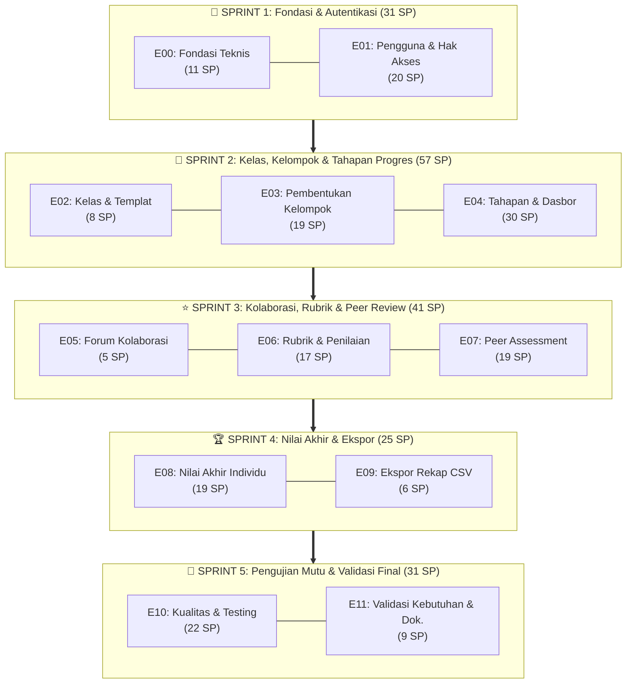

# 🗂️ Sprint Plan per Epic (5 Sprint)
**Proyek:** Pengembangan Sistem Manajemen Pembelajaran Berbasis Proyek dengan Rubrik Penilaian Digital dan Peer Assessment Berbasis Web  
**PM:** Karina Cahyasari | **Versi:** 4.0 | **Tanggal:** 23 November 2026

---

## 📊 Pemetaan 12 Epic ke dalam 5 Sprint

---

## 🚀 SPRINT 1 (E00 & E01) — 31 SP

### 1. E00 – Setup & Fondasi Teknis (11 SP)
- **PB-01 (3 SP, Must)**: Setup repositori Git (`main`, `BE`, `FE`), konfigurasi Docker dev (NestJS + React Vite + PostgreSQL), root `npm run dev`, README setup.
- **PB-02 (5 SP, Must)**: Desain ERD & skema basis data di MikroORM, migrasi bersih dari nol, relasi data mendukung anonimitas peer assessment.
- **PB-03 (3 SP, Must)**: Seed script data dummy/sintetis (matakuliah fiktif, dosen, mahasiswa, NIM acak).

### 2. E01 – Pengguna & Hak Akses (20 SP)
- **PB-04 (5 SP, Must)**: Autentikasi lokal terenkripsi (hash password, proteksi login, logout).
- **PB-05 (5 SP, Must)**: Role-based access control (RBAC) via NestJS Guard (Dosen, Mahasiswa, Admin).
- **PB-06 (5 SP, Must)**: Admin CRUD akun dan manajemen status aktif peran.
- **PB-07 (5 SP, Must)**: Admin manajemen mata kuliah & assign peserta/dosen ke kelas.

---

## 🏫 SPRINT 2 (E02, E03 & E04) — 57 SP

### 3. E02 – Kelas & Templat Proyek (8 SP)
- **PB-08 (3 SP, Must)**: Dosen membuat kelas baru terhubung dengan mata kuliah.
- **PB-09 (5 SP, Must)**: Inisiasi kelas menggunakan Project-Based Template dengan tahapan awal aktif.

### 4. E03 – Pembentukan Kelompok (19 SP)
- **PB-10 (2 SP, Must)**: Dosen memilih 3 metode pembagian tim (acak/mandiri/manual) dan kapasitas $N$.
- **PB-11 (5 SP, Must)**: Algoritma pembagian acak (randomized distribution) otomatis merata.
- **PB-12 (5 SP, Must)**: Mahasiswa memilih slot mandiri (self-enroll) aman dari race condition (database lock/constraint).
- **PB-13 (5 SP, Must)**: Dosen mengatur dan memindahkan mahasiswa antar-kelompok secara manual.
- **PB-14 (2 SP, Must)**: Mahasiswa melihat daftar rekan satu kelompoknya (terisolasi dari detail tim lain).

### 5. E04 – Tahapan & Pemantauan Progres (30 SP)
- **PB-15 (5 SP, Must)**: Dosen menambah tahapan proyek (milestone) dengan tenggat waktu.
- **PB-16 (3 SP, Must)**: Dosen mengubah, menghapus, atau menata urutan tahapan.
- **PB-17 (5 SP, Must)**: Perwakilan kelompok upload file atau tautan laporan per tahapan.
- **PB-18 (3 SP, Must)**: Kalkulasi status pengumpulan otomatis (Belum, Submitted, Terlambat).
- **PB-19 (8 SP, Must)**: Dasbor pemantauan dosen berbentuk grid kelompok × tahapan.
- **PB-20 (3 SP, Could)**: Dosen memberi komentar umpan balik pada pengumpulan kelompok.
- **PB-21 (3 SP, Could)**: Mahasiswa menerima pengingat deadline di dasbor saat tenggat mendekat.

---

## ⭐ SPRINT 3 (E05, E06 & E07) — 41 SP

### 6. E05 – Ruang Kolaborasi Kelompok (5 SP)
- **PB-22 (5 SP, Should)**: Forum diskusi internal kelompok (posting & balasan kronologis, hanya untuk anggota tim & dosen).

### 7. E06 – Rubrik & Penilaian Kelompok (17 SP)
- **PB-23 (5 SP, Must)**: Dosen membuat rubrik kustom (kriteria, bobot, deskripsi tingkat skala).
- **PB-24 (2 SP, Must)**: Validasi otomatis: total bobot rubrik wajib tepat 100%.
- **PB-25 (5 SP, Must)**: Dosen mengisi skor kelompok per kriteria rubrik.
- **PB-26 (3 SP, Must)**: Nilai total kelompok dihitung otomatis secara deterministik.
- **PB-27 (2 SP, Must)**: Konfirmasi dan finalisasi nilai kelompok oleh dosen.

### 8. E07 – Peer Assessment (19 SP)
- **PB-28 (3 SP, Must)**: Dosen membuka dan menutup periode peer assessment.
- **PB-29 (5 SP, Must)**: Mahasiswa menilai kontribusi seluruh rekan sekelompok dalam rentang skor valid.
- **PB-30 (3 SP, Must)**: Guard sistem menolak penilaian diri sendiri dan penilaian antar-kelompok.
- **PB-31 (5 SP, Must)**: Proteksi idempotensi di tingkat database (`UNIQUE` constraint) mencegah double-submit.
- **PB-32 (3 SP, Must)**: Kerahasiaan identitas penilai (anonim) di antarmuka dan sanitasi response API.

---

## 🏆 SPRINT 4 (E08 & E09) — 25 SP

### 9. E08 – Nilai Akhir Individu (19 SP)
- **PB-33 (3 SP, Must)**: Dosen mengatur konfigurasi formula dan batas faktor pengali kontribusi.
- **PB-34 (8 SP, Must)**: Perhitungan nilai akhir individu otomatis (nilai kelompok × faktor, max 100).
- **PB-35 (3 SP, Should)**: Dosen meninjau breakdown nilai dan dapat menyesuaikan sebelum publikasi.
- **PB-36 (5 SP, Must)**: Publikasi nilai akhir; mahasiswa hanya melihat nilai miliknya sendiri.

### 10. E09 – Ekspor Rekapitulasi (6 SP)
- **PB-37 (3 SP, Should)**: Dosen mengekspor rekap progres pengumpulan kelompok ke format CSV.
- **PB-38 (3 SP, Should)**: Dosen mengekspor rekap nilai kelompok dan nilai akhir individu ke CSV.

---

## 🧪 SPRINT 5 (E10 & E11) — 31 SP

### 11. E10 – Kualitas, Keamanan & Pengujian (22 SP)
- **PB-39 (3 SP, Must)**: Responsivitas antarmuka web di layar laptop dan ponsel.
- **PB-40 (5 SP, Must)**: Automated unit testing aturan bisnis inti (rubrik 100%, rumus nilai, pencegahan duplikasi).
- **PB-41 (3 SP, Must)**: Pengujian otorisasi dan hak akses matriks peran.
- **PB-42 (5 SP, Must)**: Pengujian End-to-End (E2E) alur UC-01 s/d UC-07.
- **PB-43 (3 SP, Must)**: Pengujian race condition pada self-enroll dan pengiriman peer assessment bersamaan.
- **PB-44 (3 SP, Should)**: Sesi walkthrough antarmuka dengan mahasiswa dan dosen sukarela.

### 12. E11 – Validasi Kebutuhan & Dokumentasi (9 SP)
- **PB-45 (2 SP, Must)**: Rangkuman wawancara dosen offline untuk validasi masalah dan rubrik penilaian (memperbarui PRD Bagian B).
- **PB-46 (2 SP, Should)**: Laporan kuesioner mahasiswa Informatika terkait pengalaman proyek kelompok.
- **PB-47 (3 SP, Should)**: Laporan kajian literatur peer assessment dan formula faktor pengali (FR-09).
- **PB-48 (2 SP, Must)**: Review skenario & acceptance criteria dengan dosen pembimbing, rilis PRD v0.2 / final.
